# TCSS 435 - Treasure Hunt AI Project

A Python grid-world project in which an agent searches for treasure while
avoiding traps and static walls. The project is developed in phases: a grid
GUI and uninformed search (BFS, DFS, UCS) in Assignment 1, followed by
informed/heuristic search (Greedy Best-First Search and A*) in Assignment 2.

## Team

| Name   | Role                                                                          |
|--------|-------------------------------------------------------------------------------|
| Adrian | GitHub setup, reset/regenerate functionality, README and submission packaging |
| Aramis | GUI rendering (colors, symbols, layout)                                       |
| Dylon  | Grid setup and random placement, updating REAMDME, fix minor bugs             |


## Requirements

- Python 3
- NumPy
- Pillow (PIL), if the GUI loads an image using `Image` and `ImageTk`
- Tkinter (normally included with standard Python distributions)

Install the third-party packages in the Python environment used by your IDE:  

```bash
python -m pip install numpy Pillow  
pip install numpy
```

## Project files

The main files are:

- `TreasureGridModel.py` — creates and stores the grid and the positions of
  the start, treasures, traps, and walls (supports multiple treasures and
  multiple traps, and a 20x20 default grid for Assignment 2).
- `TreasureHuntGUI.py` — displays the grid, provides the algorithm buttons
  and the Custom Grid Setup menu, and displays search results.
- `search.py` — contains the BFS, DFS, UCS, Greedy Best-First Search, and A*
  search implementations, plus the movement-cost model (traps are walkable
  but cost more than a normal move).
- `heuristics.py` — the heuristic functions (Manhattan distance, Euclidean
  distance) shared by Greedy and A*, and a helper for picking the nearest
  treasure.
- `images/` — stores image assets and experiment screenshots used by the GUI
  and this README.

## Running the program

1. Open the project directory in your IDE or terminal.
2. Activate the project's virtual environment, if you use one.
3. Install the requirements listed above.
4. Run:

```bash
python TreasureHuntGUI.py
```

If your system uses `python3` instead of `python`, run:

```bash
python3 TreasureHuntGUI.py
```

Use **Run BFS**, **Run DFS**, **Run UCS**, **Run Greedy**, **Run A\*
(Manhattan)**, or **Run A\* (Euclidean)** to execute a search and watch it
animate step by step. Every search stops at whichever treasure it reaches
first, since the grid can have more than one. Use **Regenerate Grid** for a
new random grid, or click the **☰** menu in the top-left corner to open
**Custom Grid Setup**, which shows the current grid's exact size, start,
treasure(s), trap(s), and wall coordinates and lets you edit and re-apply
them to build a specific layout.

## Implementation and design

### Grid representation

The grid is represented as a two-dimensional NumPy array. Each cell's integer
value represents its type (for example, empty, start, wall, treasure, or trap).
Grid positions are represented as `(row, column)` coordinate pairs.

The grid model also keeps track of important positions, such as the start and
treasure, and stores wall positions in a set. The GUI reads the model's grid
and draws each cell with a distinct visual appearance.

### Movement cost model

Every move costs 1, except stepping onto a trap, which costs `TRAP_COST = 5`
(chosen to match the leaderboard's -5-point penalty per trap triggered).
Traps are walkable, not blocked, so a cost-aware algorithm can choose to cut
through one when the alternative route is even more expensive, or go around
it when a cheaper detour exists. Static walls remain completely impassable.

### Uninformed search algorithms (Assignment 1)

- **Breadth-First Search (BFS):** explores the search frontier in
  first-in, first-out order. When all moves have equal cost, BFS finds a path
  with the fewest moves. It ignores the trap's higher cost, so its path isn't
  always the cheapest once traps are involved.
- **Depth-First Search (DFS):** explores one branch as far as possible before
  backtracking. It can find a solution, but it does not generally guarantee
  the path with the fewest moves or the lowest cost.
- **Uniform-Cost Search (UCS):** expands the frontier position with the lowest
  accumulated path cost, correctly accounting for the trap's higher cost.

### Informed (heuristic) search algorithms (Assignment 2)

- **Greedy Best-First Search:** expands whichever frontier position the
  heuristic estimates as closest to the goal, completely ignoring the real
  cost accumulated so far. This makes it fast (it usually expands far fewer
  nodes than UCS or A*), but it can walk straight through an expensive trap,
  or get misled around a wall into a longer path than necessary, because it
  never weighs cost against the heuristic.
- **A\* Search:** expands the frontier position with the lowest
  `f(n) = g(n) + h(n)`, where `g(n)` is the real cost from the start and
  `h(n)` is the heuristic estimate to the goal. With an admissible heuristic
  (one that never overestimates the true remaining cost), A* is guaranteed to
  find the lowest-cost path, typically while expanding far fewer nodes than
  UCS.

### Heuristic design

Both heuristics live in `heuristics.py` so Greedy and A* use the exact same
implementation, which is what makes comparing them meaningful:

- **Manhattan distance** (`|Δrow| + |Δcol|`): the number of grid moves needed
  to close the row and column gap to the goal, ignoring walls. It is
  admissible here because movement is 4-directional with a minimum step cost
  of 1 -- it can never overestimate the true cost of the cheapest remaining
  path.
- **Euclidean distance** (straight-line distance): also admissible, since it
  is always less than or equal to the Manhattan distance on a 4-directional
  grid (the straight-line distance is never more than the taxicab distance).
  It's included specifically to compare against Manhattan distance for A*, as
  the assignment asks.

**Multiple treasures:** since the grid can hold 2-3 treasures, every
algorithm's heuristic is computed as the *minimum* distance to any treasure,
and the search stops at whichever treasure is actually reached first --
not necessarily the one that looked closest at the start -- since any
treasure found is a valid outcome.

### Data structures

- **`deque` (BFS):** A FIFO queue that explores the grid level by level.
- **List (DFS):** Used as a LIFO stack; positions are popped from the end to
  explore one branch deeply before backtracking.
- **`heapq` (UCS, Greedy, A\*):** A min-priority queue; UCS and A* order by
  accumulated/estimated cost, Greedy orders by heuristic value alone.
- **Dictionaries:** Store each position's parent for path reconstruction, and
  (for UCS/A*) the lowest known cost to each position. A separate dictionary
  logs every heuristic value computed during a Greedy or A* run, for
  reporting "heuristic values computed."
- **Set:** Tracks positions that have already been expanded, for UCS/Greedy/A*.
- **Tuples and lists:** `(row, column)` tuples identify grid positions, while
  lists hold DFS frontier entries and neighboring positions.

## Comparison of BFS, DFS, and UCS

### Experiments and Results (start is image at top left corner / (x, y) = (0, 0))
- Experiment 1:  

| Algorithm | Path cost | Nodes expanded | Runtime (sec) |
|-----------|----------:|---------------:|--------------:|
| BFS       |         8 |             29 |      2.434220 |
| DFS       |        14 |             23 |      1.925177 |
| UCS       |         8 |             33 |      2.780746 |  

<p>BFS</p>  
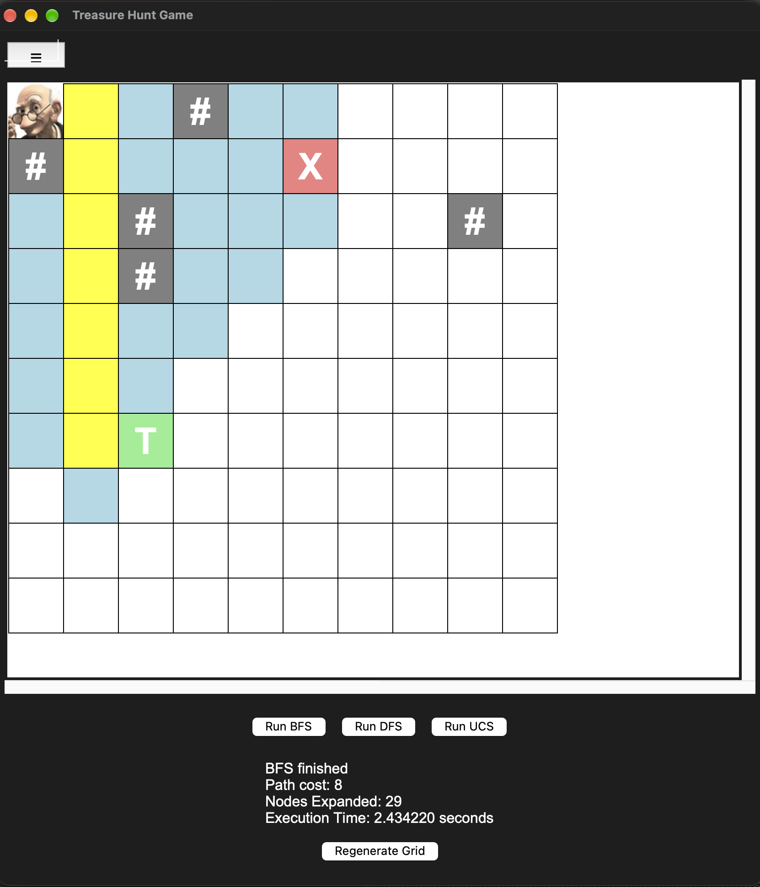  
<p>DFS</p>  
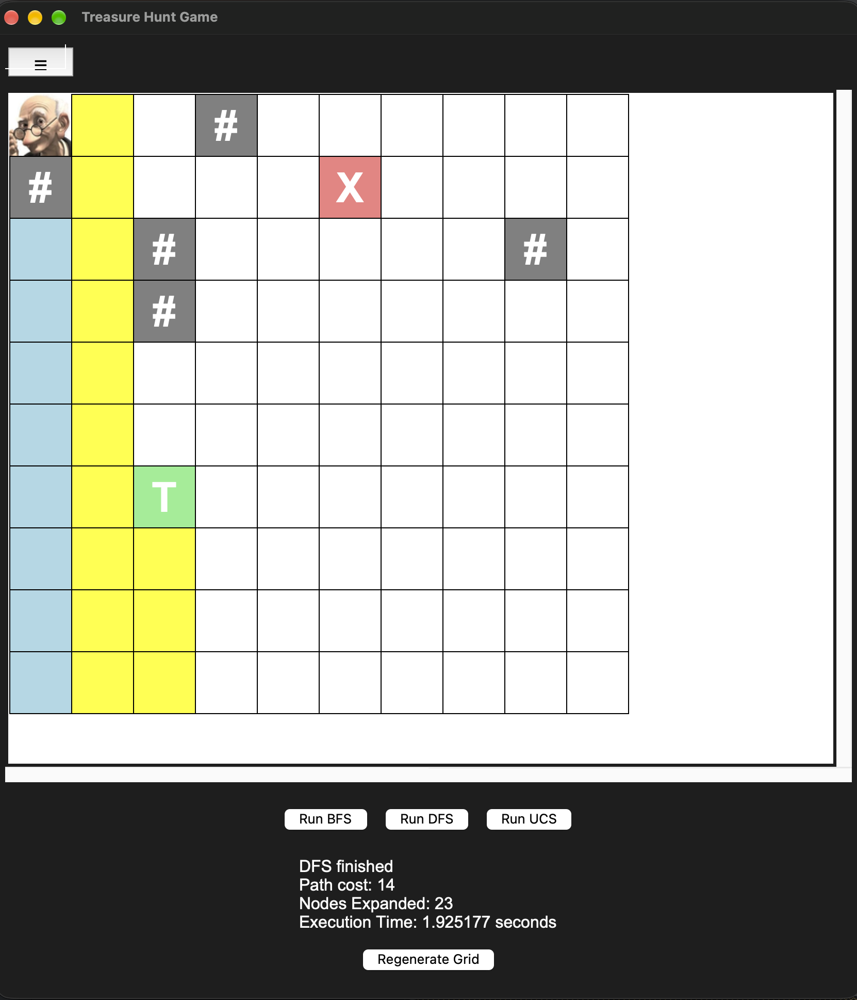  
<p>UCS</p>  
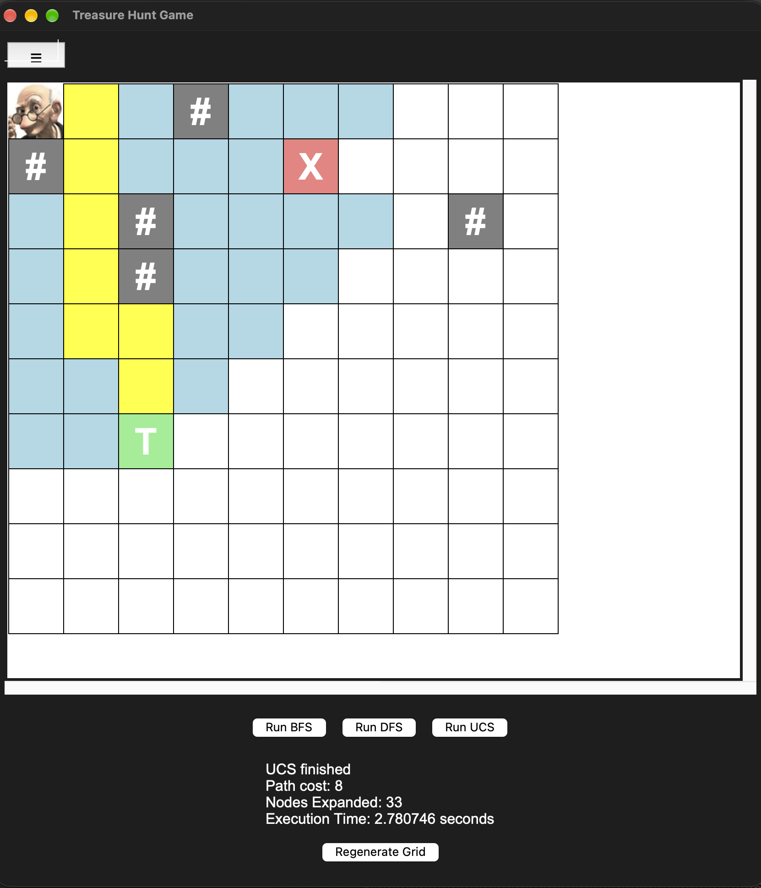  

- Experiment 2:  

| Algorithm | Path cost | Nodes expanded | Runtime (sec) |
|-----------|----------:|---------------:|--------------:|
| BFS       |        18 |             94 |      7.916413 |
| DFS       |        60 |             84 |      7.072630 |
| UCS       |        18 |             94 |      7.925289 |  

<p>BFS</p>  
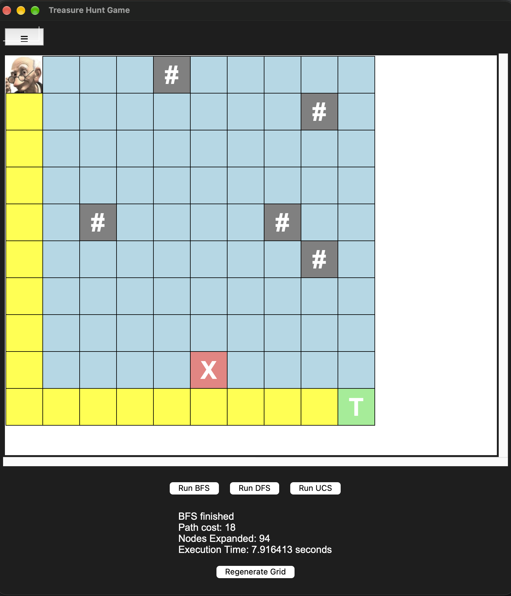  
<p>DFS</p>  
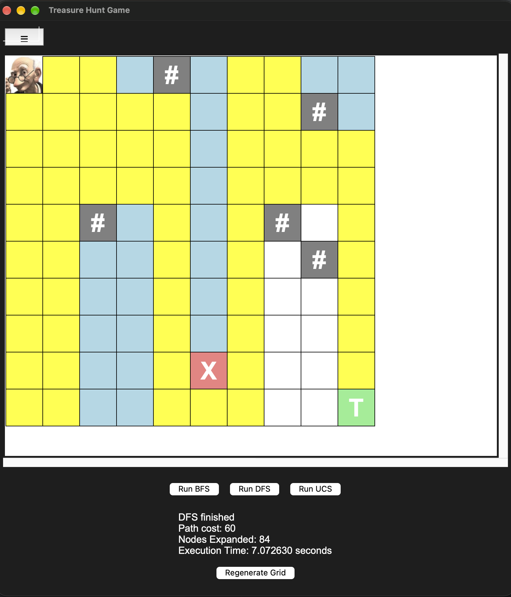  
<p>UCS</p>  
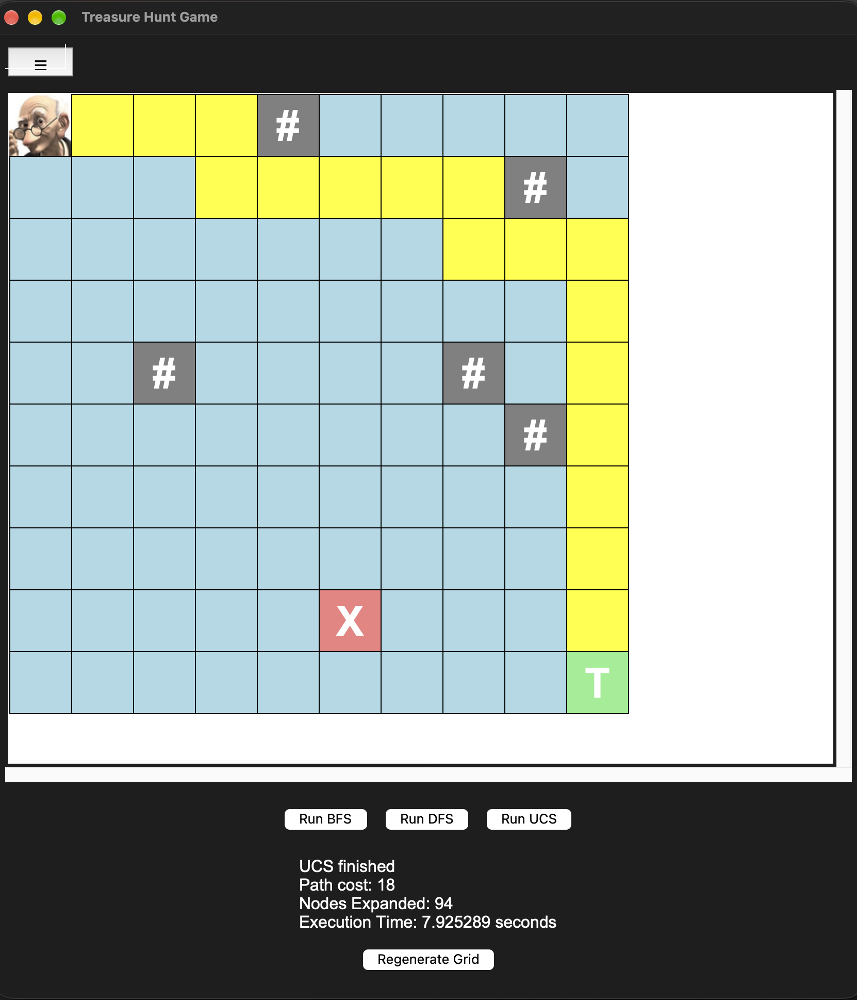  

- Experiment 3:  

| Algorithm | Path cost | Nodes expanded | Runtime (sec) |
|-----------|----------:|---------------:|-------------:|
| BFS       |         9 |             47 |     3.958120 |
| DFS       |        47 |             60 |     5.056451 |
| UCS       |         9 |             40 |     3.357781 |  

<p>BFS</p>  
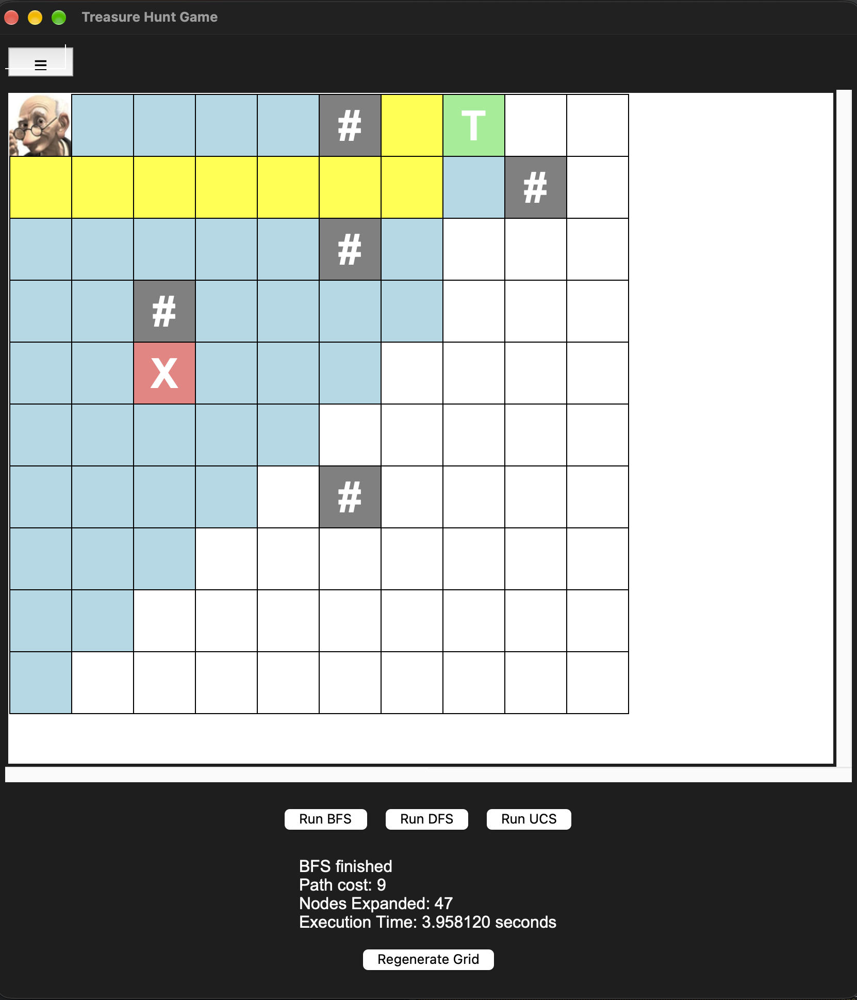  
<p>DFS</p>  
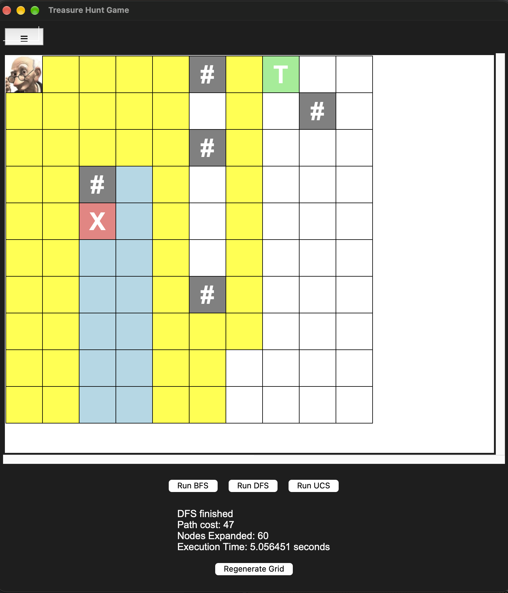  
<p>UCS</p>  
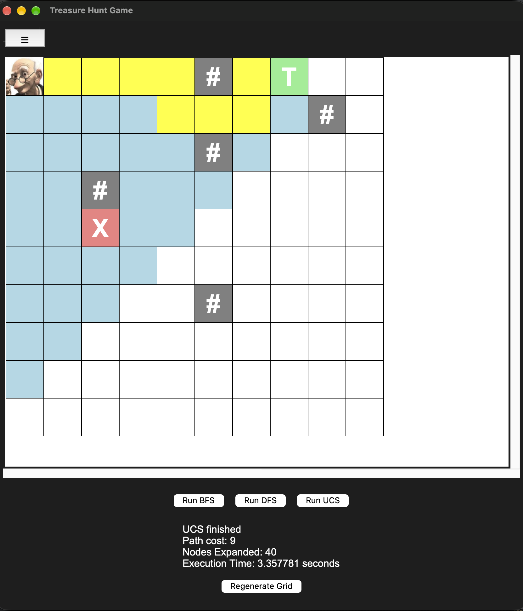  
  
- Averages  

| Algorithm | Average Path cost | Average Nodes expanded | Avergae Runtime (sec) |
|-----------|------------------:|-----------------------:|---------------------:|
| DFS       |                40 |                     55 |             4.684753 |
| BFS       |                11 |                     56 |             4.769584 |
| UCS       |                11 |                     55 |             4.687939 |  


### Discussion of Results


- Which algorithm returned the lowest path cost?  
BFS and UCS always tied for path cost because, the cost of a path  
is always based on how many squares are traversed.  
  

- Which algorithm expanded the fewest nodes?  
  All three algorithms appeared to expand the same amount of nodes  
however, given the grid is only 10x10 the results are somewhat misleading.  
Further experimentation would be needed on much bigger grids to determine  
the differences in expanded nodes amongst BFS, DFS, and UCS.  


- Which algorithm had the shortest runtime?  
  Overall, DFS ran a bit shorter. This is rather misleading given that DFS with a much bigger  
grid should run slower but, because the grid is 10x10 the runtime seems trivial  
since all three algorithms do not need to traverse much to find the treasure.

## Comparison of A* and Greedy Best-First Search

### Measurement note

Runtime is measured from the plain `greedy_best_first()`/`a_star()` functions
directly, the same way as Assignment 1 -- not through the GUI's animated
step-by-step visualization, which adds an artificial delay between steps
purely for display and would measure the animation speed rather than the
algorithm's actual speed.

### Experiments and Results (grid is 20x20 for all three experiments)

- Experiment 1 (plain random grid -- typical case, 2 treasures, 2 traps, 10 walls):

| Algorithm        | Path cost | Nodes expanded | Runtime (sec) | Traps triggered | Heuristic values computed |
|------------------|----------:|----------------:|---------------:|-----------------:|---------------------------:|
| Greedy           |        18 |              19 |       0.000116 |                0 |                         52 |
| A* (Manhattan)   |        18 |              36 |       0.000135 |                0 |                         54 |
| A* (Euclidean)   |        18 |              36 |       0.000132 |                0 |                         54 |

<p>Greedy</p>

<p>A* (Manhattan)</p>
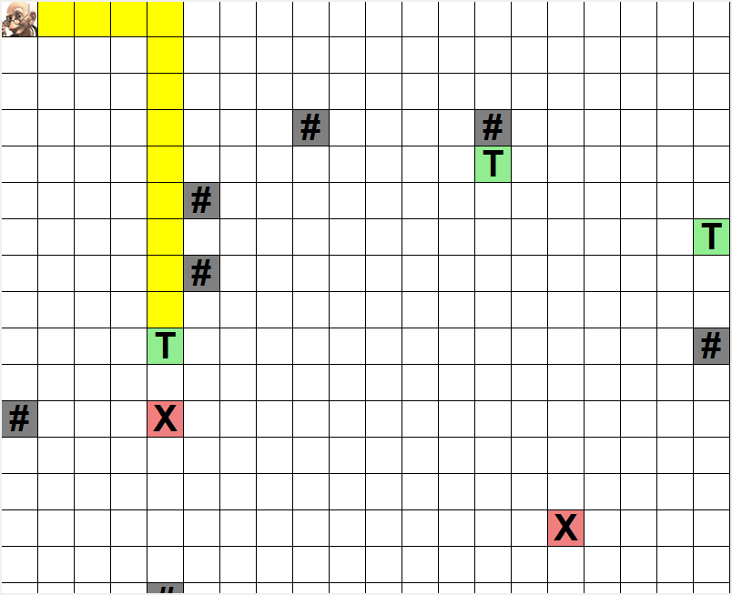
<p>A* (Euclidean)</p>
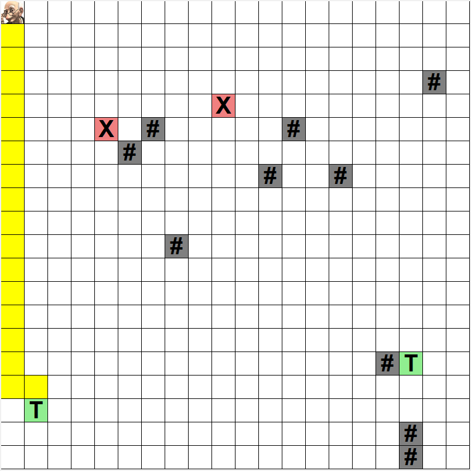

- Experiment 2 (a trap sits directly between the start and the nearest
  treasure, with an open, cheaper detour available just below it):

| Algorithm        | Path cost | Nodes expanded | Runtime (sec) | Traps triggered | Heuristic values computed |
|------------------|----------:|----------------:|---------------:|-----------------:|---------------------------:|
| Greedy           |        14 |              11 |       0.000057 |                1 |                         21 |
| A* (Manhattan)   |        12 |              21 |       0.000074 |                0 |                         34 |
| A* (Euclidean)   |        12 |              21 |       0.000089 |                0 |                         34 |

<p>Greedy</p>

<p>A* (Manhattan)</p>
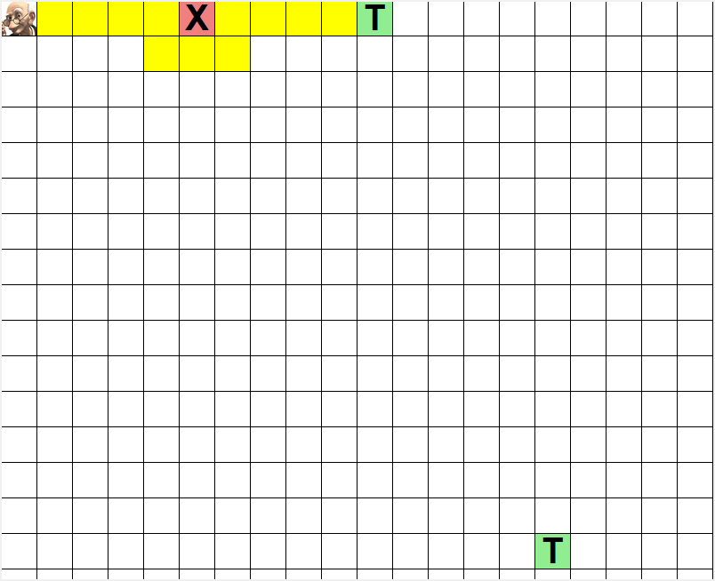
<p>A* (Euclidean)</p>
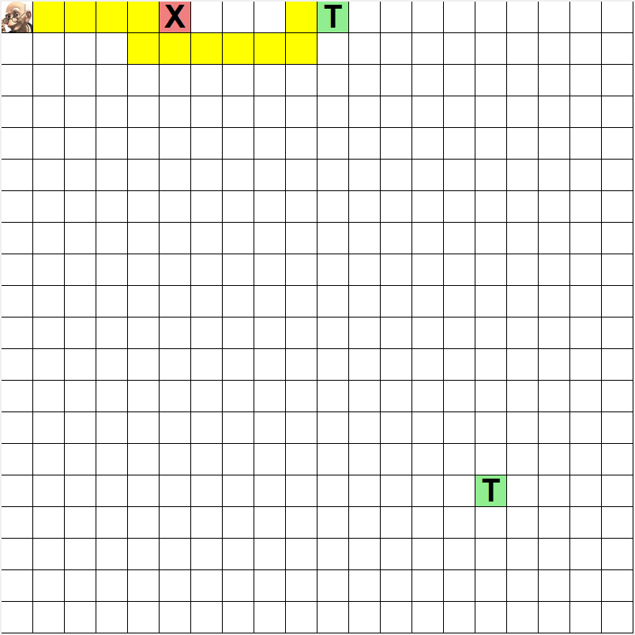

- Experiment 3 (a U-shaped wall sits between the start and the nearest
  treasure by straight-line distance, forcing a long detour around it):

| Algorithm        | Path cost | Nodes expanded | Runtime (sec) | Traps triggered | Heuristic values computed |
|------------------|----------:|----------------:|---------------:|-----------------:|---------------------------:|
| Greedy           |        46 |             149 |       0.000640 |                0 |                        181 |
| A* (Manhattan)   |        36 |             221 |       0.000787 |                0 |                        250 |
| A* (Euclidean)   |        36 |             226 |       0.000770 |                0 |                        255 |

<p>Greedy</p>
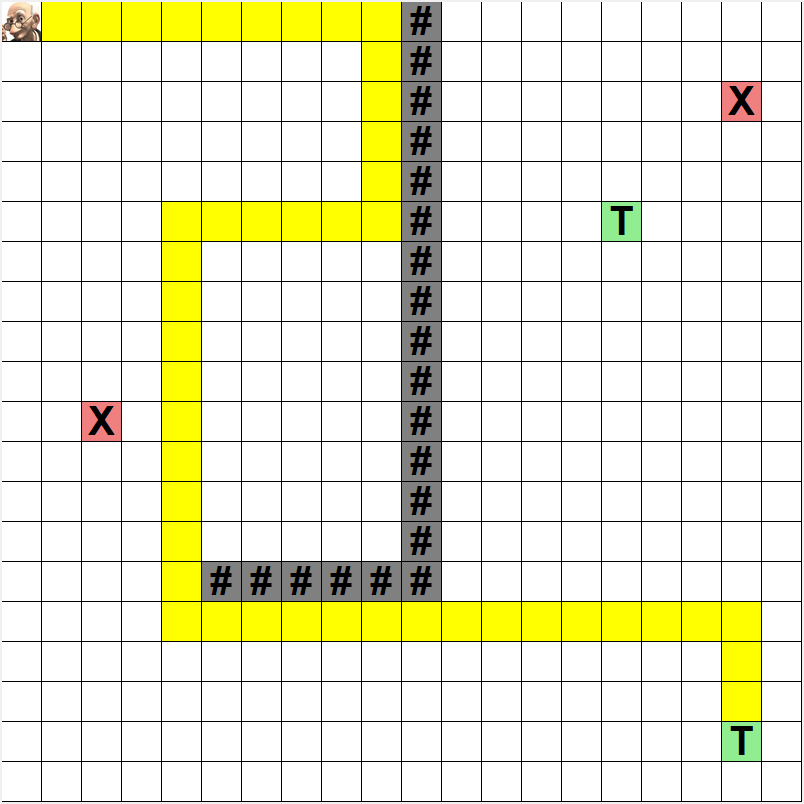
<p>A* (Manhattan)</p>
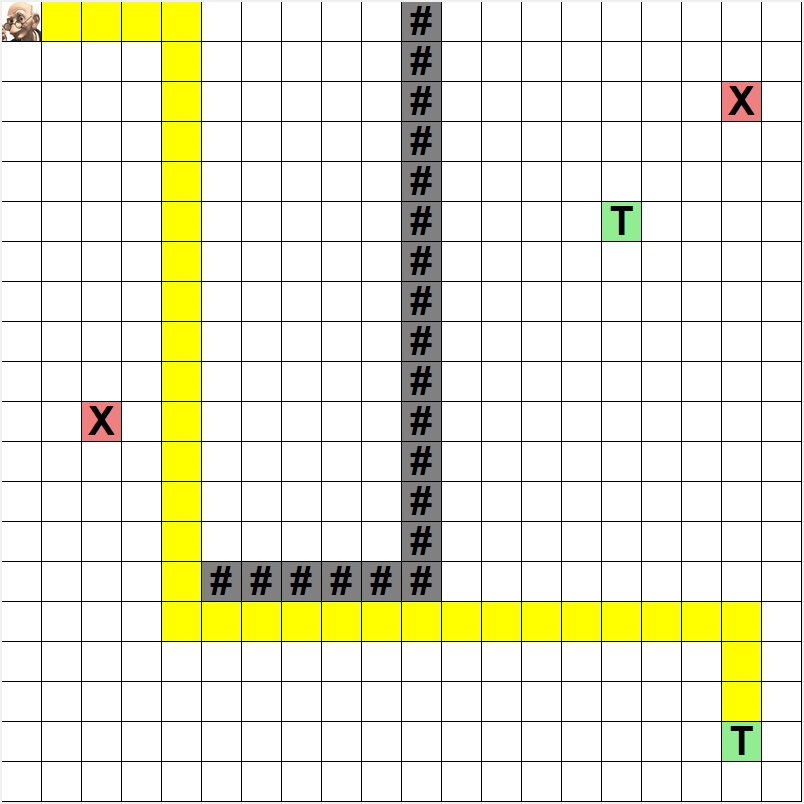
<p>A* (Euclidean)</p>
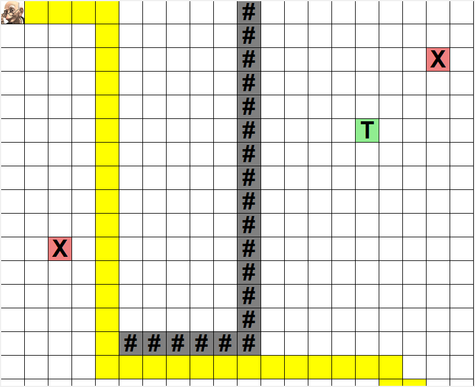

- Averages

| Algorithm        | Average Path cost | Average Nodes expanded | Average Runtime (sec) | Traps triggered (total) |
|------------------|-------------------:|-------------------------:|------------------------:|--------------------------:|
| Greedy           |               26.0 |                     59.7 |                0.000259 |                          1 |
| A* (Manhattan)   |               22.0 |                     92.7 |                0.000435 |                          0 |
| A* (Euclidean)   |               22.0 |                     94.3 |                0.000459 |                          0 |

### Discussion of Results

**Efficiency:** Greedy consistently expanded the fewest nodes (59.7 on
average vs. ~93-94 for A*) and ran fastest, since it never has to maintain or
compare accumulated path costs -- it always trusts the heuristic alone. This
is the expected trade-off: Greedy is cheaper to run but has no guarantee of
quality.

**Accuracy:** A* matched or beat Greedy's path cost in every experiment, and
never triggered a trap. In Experiment 2, Greedy walked directly through the
trap (cost 14, 1 trap triggered) because the trap cell looked closer to the
goal by straight-line distance, with no awareness that stepping on it costs
5x a normal move; A* correctly weighed that extra cost against the open
detour and routed around it (cost 12, 0 traps triggered). In Experiment 3,
Greedy committed to the wall-side route that looked closest to the treasure,
got stuck needing to backtrack around the U-shaped dead end, and ended up
with a noticeably worse path (cost 46 vs. A*'s optimal 36) despite expanding
far fewer nodes. This is exactly the failure mode Greedy is known for: it can
be led into a bad decision by a misleading local heuristic value, since it
never reconsiders based on the cost already spent.

**Manhattan vs. Euclidean for A\*:** both heuristics are admissible on this
grid (4-directional movement), and both produced the identical optimal path
cost in every experiment, as expected -- admissible heuristics guarantee
optimality regardless of which one is used. The difference shows up in the
heuristic *values* themselves (Euclidean is always <= Manhattan, since
straight-line distance never exceeds taxicab distance) and, in Experiment 3,
in nodes expanded: Euclidean's smaller, "flatter" estimates give A* slightly
less guidance toward the goal there, so it expanded a few more nodes than
Manhattan (226 vs 221). Experiments 1 and 2 tied exactly on nodes expanded
(36 vs 36, and 21 vs 21) -- the two heuristics only diverge in how much they
help prune the search when the extra detour around an obstacle is long
enough for Euclidean's looser estimate to matter.

## Sample GUI screenshot

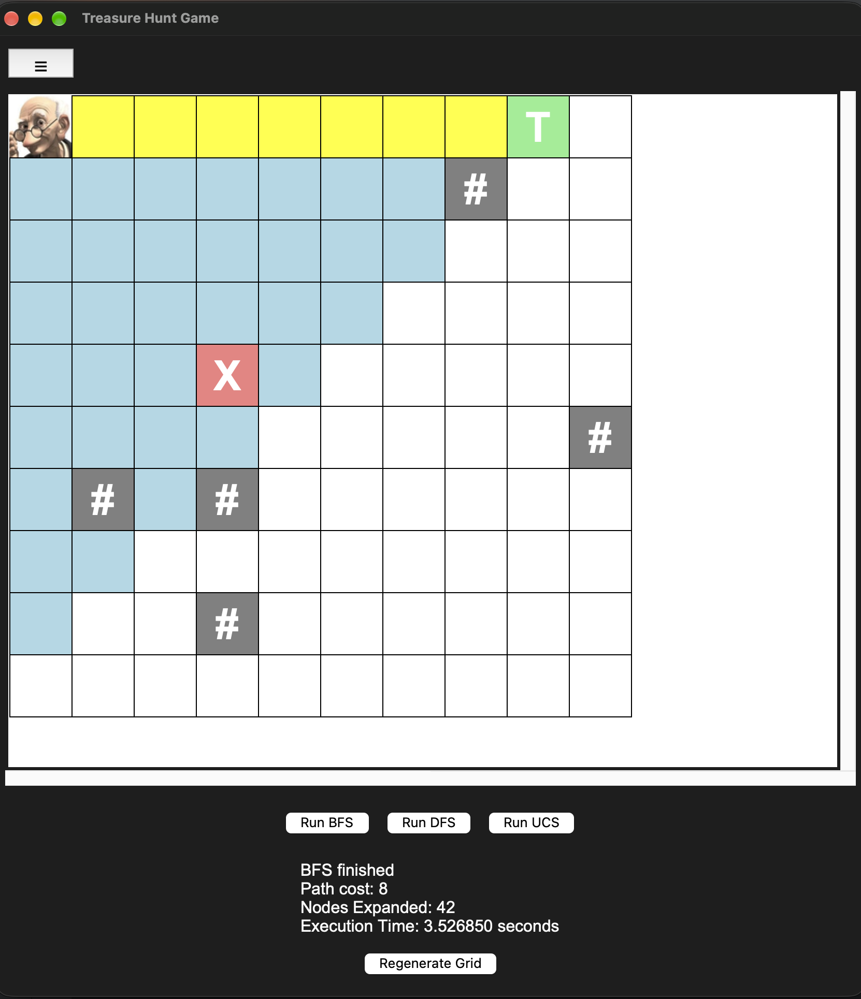


## Generative AI Statement

1. What was used: ChatGPT  
How it was used: to make png image appear on the start position  
Which parts of the work are original vs. AI-assisted: lines 45-46 and 4-5  
for importing appropriate libs and loading and sizing image.  
2. What was used: ChatGPT  
How it was used: help with resizing increasing grid sizes 10x10, 20x20 and bigger  
to help make the view of the grid not take up too much space so that buttons are  
still accessible.
3. What was used: Claude (Anthropic)  
How it was used: implemented Greedy Best-First Search and the GUI's animated
step-by-step visualization and timing fix, designed the movement-cost model
for traps, fixed bugs in the team's A* implementation (a crash on unreachable
goals and an incorrect runtime measurement), and extended every search
algorithm to stop at whichever of several treasures is reached first instead
of only a single pre-chosen one.  
Which parts of the work are original vs. AI-assisted: the core algorithm
logic for BFS, DFS, UCS, and the original A* implementation were written by
the team; the Greedy implementation, the multi-treasure/trap-cost
extensions, and the associated bug fixes described above were AI-assisted
and reviewed/tested by the team before merging.

## Workflow

- Keep `main` working and mergeable.
- Work on separate feature branches and open pull requests into `main`.
- Have at least one other teammate review changes before merging.

## Sources
- image used for start position here: [https://pixar.fandom.com/wiki/Geri](https://pixar.fandom.com/wiki/Geri)


# Assignment 3 — Adversarial Search

## Overview

For Assignment 3, we added Minimax and Alpha-Beta Pruning to our Treasure Hunt project. Instead of having one agent search for treasure, we now have two agents competing to collect the most treasures.

Agent A tries to maximize its score, while Agent B tries to minimize Agent A's advantage. Both agents take turns moving around the grid.

We also implemented two evaluation functions and tested how different search depths affected the algorithms' performance.

## Grid Setup

We updated the grid to meet the Assignment 3 requirements:

- 15×15 grid
- 3–5 randomly generated treasures
- 2–3 traps
- Static walls
- Two agents that alternate turns

Both agents can move up, down, left, or right. They cannot move through walls or occupy the same position.

The game ends when all treasures are collected, an agent has no legal move, or the game reaches the 200-turn limit.


## Minimax

Minimax is a search algorithm used for games involving two players.

Agent A is the maximizing player, while Agent B is the minimizing player. The algorithm looks ahead at possible moves and evaluates the resulting game states.

Since searching every possible move would take too long, we use depth-limited search. Once the depth limit is reached, the evaluation function estimates how good the current state is.

## Alpha-Beta Pruning

Alpha-Beta works similarly to Minimax, but it skips branches that will not affect the final decision.

It uses two values, alpha and beta, to keep track of the best options found for the maximizing and minimizing players.

We implemented Alpha-Beta to see whether we could reduce the number of nodes expanded without changing the game outcome.

## Evaluation Functions

We used two evaluation functions.

**Distance-based:** This function considers the distance to the nearest treasure, proximity to traps, and the number of treasures each agent has collected. It encourages agents to move toward available treasures while avoiding risky positions.

**Treasure competition:** This function compares how far each agent is from the remaining treasures. It gives Agent A a higher score when it is closer to treasures than Agent B. It also accounts for collected treasures and trap positions.

We compared both functions to see which one helped Agent A perform better.

## Experiments

We tested Minimax and Alpha-Beta on three different 15×15 grids using the Distance-based evaluation function.

For each grid, we tested depths 2, 4, and 6. We ran both algorithms on the same grid before changing configurations so the comparisons would be fair.

We recorded the nodes expanded, execution time, pruning ratio, turns played, and game outcome.

*(These experiments were re-run twice: once after fixing a tie-breaking bug in Minimax and Alpha-Beta that had been causing some games -- especially with the Treasure competition evaluation function -- to loop indefinitely and hit the 200-turn cap instead of finishing normally, and again after adding an opponent-distance term to the Distance-based evaluation function. The numbers below reflect the current code; no game in this round reached the turn limit.)*

### Grid 1

| Algorithm | Depth | Nodes Expanded | Time (s) | Pruning Ratio | Outcome |
|---|---:|---:|---:|---:|---|
| Minimax | 2 | 812 | 0.005653 | N/A | Win (3–2) |
| Alpha-Beta | 2 | 711 | 0.004657 | 12.44% | Win (3–2) |
| Minimax | 4 | 9,414 | 0.053528 | N/A | Loss (2–3) |
| Alpha-Beta | 4 | 5,688 | 0.034396 | 16.29% | Loss (2–3) |
| Minimax | 6 | 107,557 | 0.616062 | N/A | Win (3–2) |
| Alpha-Beta | 6 | 27,667 | 0.172541 | 28.30% | Win (3–2) |

Grid 1 was the one case where the outcome wasn't a clean function of depth: Agent A won at depth 2, lost at depth 4, then won again at depth 6. This shows that increasing search depth doesn't guarantee steadily improving decisions -- it only guarantees the agent considers more of the game tree, and how that translates into a move still depends on the evaluation function. Node counts still grew sharply with depth, from 812 at depth 2 to 107,557 at depth 6 for Minimax.

Alpha-Beta reduced the number of nodes expanded by about 74.3% at depth 6 while producing the same outcome.

### Grid 2

| Algorithm | Depth | Nodes Expanded | Time (s) | Pruning Ratio | Outcome |
|---|---:|---:|---:|---:|---|
| Minimax | 2 | 995 | 0.005764 | N/A | Win (4–0) |
| Alpha-Beta | 2 | 819 | 0.005098 | 17.69% | Win (4–0) |
| Minimax | 4 | 11,629 | 0.067619 | N/A | Win (4–0) |
| Alpha-Beta | 4 | 5,440 | 0.034306 | 26.37% | Win (4–0) |
| Minimax | 6 | 76,013 | 0.460837 | N/A | Win (3–1) |
| Alpha-Beta | 6 | 21,470 | 0.140141 | 26.76% | Win (3–1) |

Agent A won on Grid 2 at every depth we tested, though the margin narrowed at depth 6 (3–1) compared with a clean sweep at depths 2 and 4 (4–0) -- the deeper search let Agent B collect one treasure instead of none.

At depth 6, Alpha-Beta expanded 21,470 nodes compared with Minimax's 76,013, which was about a 71.8% reduction.

### Grid 3

| Algorithm | Depth | Nodes Expanded | Time (s) | Pruning Ratio | Outcome |
|---|---:|---:|---:|---:|---|
| Minimax | 2 | 688 | 0.003764 | N/A | Loss (2–3) |
| Alpha-Beta | 2 | 486 | 0.003016 | 29.36% | Loss (2–3) |
| Minimax | 4 | 9,594 | 0.053365 | N/A | Loss (2–3) |
| Alpha-Beta | 4 | 3,091 | 0.019616 | 35.43% | Loss (2–3) |
| Minimax | 6 | 101,798 | 0.562868 | N/A | Win (4–1) |
| Alpha-Beta | 6 | 13,582 | 0.088480 | 34.98% | Win (4–1) |

Grid 3 lost at depths 2 and 4 (2–3), then won decisively at depth 6 (4–1), showing that in this case the extra lookahead did pay off.

At depth 6, Alpha-Beta expanded about 86.7% fewer nodes than Minimax and finished in less time.

## Overall Depth Comparison

Looking at all three grids, Alpha-Beta expanded fewer nodes and ran faster than Minimax at every depth we tested, and the reduction grew as depth increased.

| Grid | Minimax Nodes (Depth 6) | Alpha-Beta Nodes (Depth 6) | Reduction at Depth 6 |
|---|---:|---:|---:|
| Grid 1 | 107,557 | 27,667 | 74.3% |
| Grid 2 | 76,013 | 21,470 | 71.8% |
| Grid 3 | 101,798 | 13,582 | 86.7% |

Both algorithms had the same final treasure counts and outcomes in every matched test, confirming that Alpha-Beta's pruning never changes the result -- only how much work it takes to get there.

Depth did not uniformly improve the outcome in this round: Grid 1 did best at depths 2 and 6 but dipped at depth 4, Grid 2 won at every depth (though the margin narrowed at depth 6), and Grid 3 needed depth 6 to turn a loss into a win. This shows that a depth-limited evaluation function's own quality matters as much as how deep it searches -- more lookahead only helps once the extra plies actually change which move looks best. We also noticed that the pruning ratio climbed at higher depths in every grid, which makes sense since a deeper tree gives Alpha-Beta more opportunities to cut off branches early.

Overall, Alpha-Beta was consistently more efficient than Minimax, especially when searching deeper, even though deeper search did not always improve Agent A's result.

## Comparing Evaluation Functions

We also tested Distance-based and Treasure competition using Alpha-Beta at depth 4, re-using the same three grids as above.

| Grid | Evaluation Function | Nodes Expanded | Time (s) | Turns | Treasures (A–B) | Outcome |
|---|---|---:|---:|---:|---|---|
| 1 | Distance-based | 5,688 | 0.032239 | 46 | 2–3 | Loss |
| 1 | Treasure competition | 5,907 | 0.031301 | 50 | 3–2 | Win |
| 2 | Distance-based | 5,440 | 0.034583 | 65 | 4–0 | Win |
| 2 | Treasure competition | 4,944 | 0.028089 | 59 | 3–1 | Win |
| 3 | Distance-based | 3,091 | 0.020072 | 38 | 2–3 | Loss |
| 3 | Treasure competition | 4,539 | 0.025194 | 71 | 2–3 | Loss |

With the opponent-distance term added to Distance-based, it won 1 of 3 grids (Grid 2) at depth 4, while Treasure competition won 2 of 3 (Grids 1 and 2); both lost Grid 3. This is closer than our very first (pre-bug-fix) comparison, where Treasure competition looked clearly worse because it kept hitting the 200-turn cap.

Node counts were similar in magnitude for both functions at depth 4, so neither evaluation function was clearly more expensive to run than the other.

Based on this data, we still can't say either evaluation function is consistently better -- the outcome depended more on search depth and the specific grid layout than on which evaluation function was used. We only compared the two functions on three grids, so a larger sample would be needed to draw a firmer conclusion.

## What We Learned

The biggest thing we noticed was how much search depth affects performance.

Increasing depth from 2 to 6 made Minimax expand significantly more nodes and increased its runtime, but it did not uniformly improve the outcome: Grid 1 actually won at depths 2 and 6 but lost at depth 4, while Grids 2 and 3 either held steady or turned a loss into a win as depth increased. More lookahead only helps when the extra plies actually change which move the evaluation function prefers.

Alpha-Beta helped reduce the amount of searching required. In our experiments, it consistently expanded fewer nodes than Minimax and produced the same final results.

We also learned that the evaluation function matters, and that a bug in either evaluation function or the search's move selection can be easy to mistake for a "weaker" evaluation function. Before we fixed a tie-breaking bug, Treasure competition looked clearly worse than Distance-based because it kept stalling and hitting the turn limit. After the fix, it performed at least as well as Distance-based at depth 4 in our sample. This was a good reminder to verify an algorithm is working correctly before drawing conclusions from its evaluation results.

## Conclusion

For Assignment 3, we added two-player Minimax and Alpha-Beta Pruning to our Treasure Hunt project and tested them at different depths.

Our results showed that Alpha-Beta was more efficient than Minimax, especially at depth 6. It reduced node expansions and execution time while always producing the same final outcome as Minimax at the same depth. Depth did not uniformly improve Agent A's results, however: Grid 1 did better at depths 2 and 6 than at depth 4, while Grid 3 needed depth 6 to turn a loss into a win.

We also compared two evaluation functions, after adding an opponent-distance term to Distance-based so it accounts for treasures, traps, opponent distance, and remaining treasures. At depth 4, Treasure competition won 2 of our 3 test grids and Distance-based won 1 of 3, with both losing the same grid. Neither function was consistently better across our tests; search depth and the specific grid layout mattered more than the choice of evaluation function.

Overall, this assignment helped us understand the tradeoff between searching deeper, choosing an appropriate evaluation function, and keeping the algorithm efficient.

## Generative AI Statement — Assignment 3

We used ChatGPT to help organize our experimental results, calculate performance differences, and revise the README explanations. The actual experiment results came from running our program and recording the displayed metrics.


